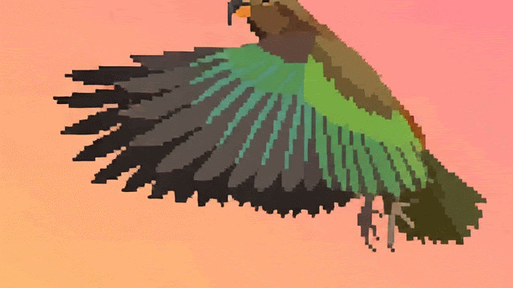
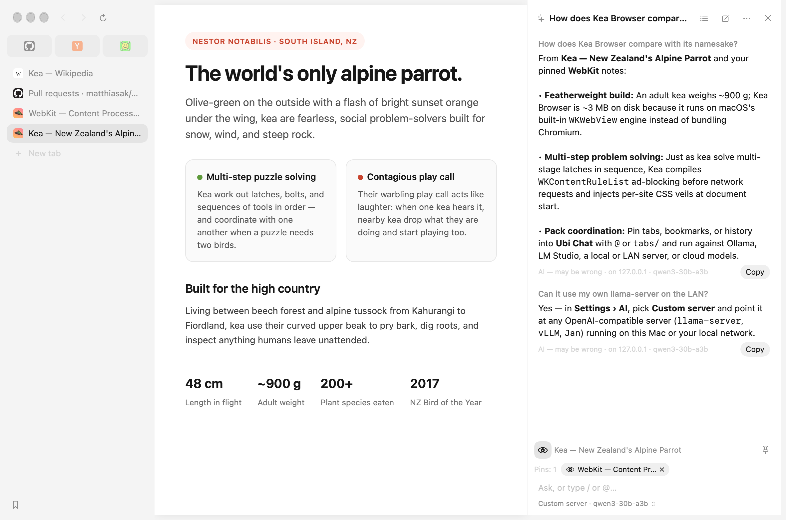
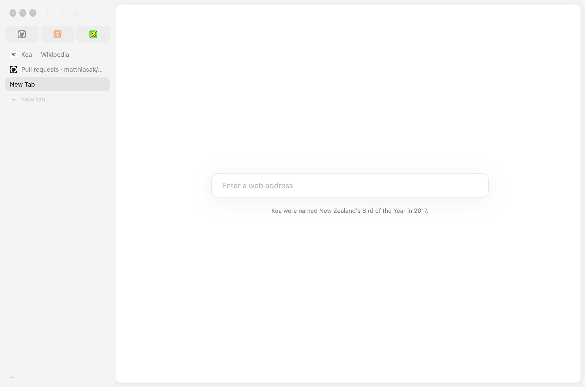
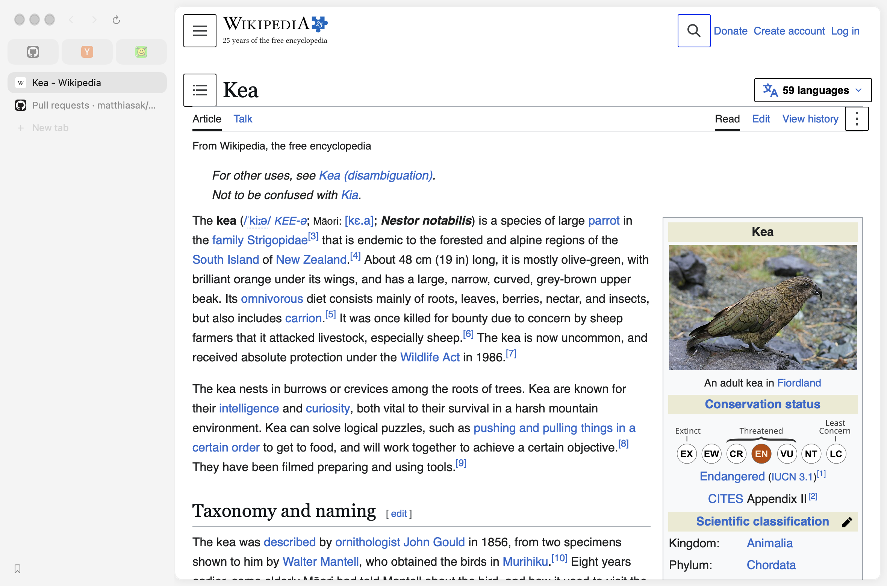

<p align="center">
  
</p>

<h1 align="center">Kea</h1>

<p align="center">
  <b>A small, cheeky Mac browser with nothing in the way.</b><br>
  Native WebKit · SwiftUI · Contextual AI (Ubi Chat) · Chrome Extensions · Built from source.<br>
  <i>Named after New Zealand's alpine parrot — curious, quick, and hard to keep out of anything.</i>
</p>

<p align="center">
  
</p>

---

## Why Kea?

Most browsers have become operating systems that want an account, a cloud sync, a start-page news feed, and a 300 MB Chromium binary. **Kea** is a ~3 MB native macOS tool built on the **WebKit** engine already inside your Mac:

- **Nothing around the page.** A strip of tabs across the top or a column down the side (`⇧⌘S`), one address field (`⌘L`), and your page.
- **Ubi Chat (`⇧⌘Y`) — contextual AI on your terms.** Summarize the active page, pin multiple tabs/bookmarks/history items with `@` or `tabs/`, and chat against **Ollama**, **LM Studio**, any **Custom OpenAI-compatible server** on this Mac or your LAN (`llama-server`, `vLLM`, `Jan`), or cloud models (**Anthropic**, **OpenAI**, **Google Gemini**, **OpenRouter**, and the **models.dev** catalog).
- **Chrome extensions, without Chrome.** Install directly from the Chrome Web Store or load unpacked folders (`WKWebExtension` on macOS 15.4+, with Kea's native Chrome API shims).
- **DIY by design.** No installer binary, no background updater, no telemetry. You clone it, run `./build.sh`, and own the binary running on your machine.

<table>
  <tr>
    <td width="50%" valign="top">
      
      <p align="center"><sub><b>New Tab:</b> one field and a daily fact about the bird (switchable in Settings › General).</sub></p>
    </td>
    <td width="50%" valign="top">
      
      <p align="center"><sub><b>Sidebar & Pins:</b> pinned tabs wear their site icons; sleeping tabs cost zero processes until clicked.</sub></p>
    </td>
  </tr>
</table>

---

## Build & Install

**Requirements:** macOS 14 or later, and Swift 6 from the Command Line Tools (`xcode-select --install`) or Xcode.

```sh
git clone https://github.com/matthiasak/kea.git
cd kea
./build.sh
```

`./build.sh` compiles a release binary with `-Osize`, strips symbols, generates `AppIcon.icns` from `Icon/kea.png`, signs the bundle (Developer ID if one is in your keychain, otherwise ad-hoc), and installs `/Applications/Kea.app`.

To update later:

```sh
git pull && ./build.sh
```

| Command | What it does |
|---|---|
| `./build.sh` | Release build, installed to `/Applications/Kea.app`; removes `build/` |
| `./build.sh debug` | Debug build, installed to `/Applications/Kea.app` |
| `./build.sh release test` | Builds `build/Kea.app` and stops without touching `/Applications` |
| `KEA_INSTALL=0 ./build.sh` | Same as `release test` |
| `KEA_ARCH=x86_64 ./build.sh` | Build for Intel Macs (default: host architecture) |
| `KEA_SIGN_IDENTITY="…" ./build.sh` | Sign with a specific Developer ID identity |

---

## Features

### Browsing & Layout
- **One field (`⌘L`).** Type an address or search terms, or type `red` / `yout` + `Tab` to search a site directly via OpenSearch. Optional address bar commands (`settings`, `new tab`) take you straight there.
- **Tabs & Spaces.** Hold tabs across the top or in a left/right sidebar (`⇧⌘S`), fold the sidebar away (`⌘S`), group tabs, or separate work and personal sign-ins into isolated **Spaces** (`⌃1`–`⌃9`).
- **Split View (`⌥⌘N`).** Pair two pages side by side in one tab slot, drag the gutter to resize, and jump between panes with `⌃⌘←` and `⌃⌘→`.
- **Bookmarks sidebar (`⌃⌘B`) & bar (`⇧⌘B`).** Full bookmark manager with multi-select, batch move/delete, undo (`⌘Z`), and **Organize with AI**.
- **Reading mode (`⇧⌘R`) & Floating video (`⇧⌘P`).** Strip clutter to the article, or float a playing video over every space when you switch tabs or apps.
- **Peek (`Shift-click`) & Little Kea (`⌘O`).** Preview links in a sheet over the page; press `esc` to dismiss or keep them as a tab.

### Ubi Chat & AI (`⇧⌘Y`)
- **Multi-resource context.** Automatically reads the visible text of the active tab (toggleable via the eye icon) plus any tabs, bookmarks, or history pages you pin via `@`, `tabs/`, `bookmarks/`, or `history/`.
- **Hallucination guard.** Links or domains in an AI answer that weren't in the shared pages are flagged inline (`⚠ Not in the pages shared`).
- **Local, LAN, or Cloud.**
  - **On this Mac / LAN:** Ollama (`127.0.0.1:11434`), LM Studio (`127.0.0.1:1234`), or **Custom server** (any `http`/`https` OpenAI-compatible server on `localhost`, private RFC1918 IPv4, link-local, `.local`, or `.home.arpa`, with optional API key).
  - **Cloud:** Anthropic, OpenAI, Google Gemini, OpenRouter (one-click OAuth PKCE sign-in), plus providers from the `models.dev` catalog.
  - **Key sources:** Store keys in the macOS Keychain, read from an `$ENV_VAR`, or fetch on demand from a shell command (e.g. `op read …`).
- **Dual-format copy.** Copying an answer puts both rich HTML and clean Markdown on the pasteboard.

### Privacy, Security & Extensions
- **Zero-cost ad blocking.** Compiles a `WKContentRuleList` enforced inside WebKit's network layer before requests leave the Mac. Toggle per site from the address bar's site card.
- **Hide anything (`⇧⌘H`).** Click cookie banners, overlays, or side rails to hide them permanently on that site via an injected document-start stylesheet.
- **Keychain passwords & Passkeys.** Saved logins live in your macOS login keychain tagged `Kea` and unlock with Touch ID; nothing is stored in plaintext on disk. One-click import from Chrome, Arc, Brave, Edge, Firefox, or Safari exports.
- **Chrome extensions (`macOS 15.4+`).** Click **Add to Kea** on any Chrome Web Store page or load an unpacked extension folder. `ExtensionShims.swift` bridges `bookmarks`, `history`, `downloads`, `sidePanel`, `offscreen`, `tabGroups`, `userScripts`, `privacy`, `browsingData`, `tts`, `identity`, and native messaging.

---

## Where Everything Lives

| Data | Location | Access |
|---|---|---|
| Passwords | macOS login keychain (`Kea`) | Kea (via macOS Keychain / Touch ID) |
| AI API keys | Keychain (`app.kea.browser.ai`), `$ENV`, or shell command | Read only at request time; never logged or written to disk |
| Bookmarks, history, session, hidden rules, Ubi Chat | `~/Library/Application Support/Kea/*.json` | Local files on your Mac |
| Cookies & site storage | `~/Library/WebKit/app.kea.browser/` | WebKit's per-space data stores |
| Extensions | `~/Library/Application Support/Kea/Extensions/` | Each extension within its granted permissions |

---

## Keyboard Shortcuts

| Navigation & Tabs | Page, Panels & AI |
|---|---|
| `⌘L` Open address field | `⇧⌘Y` Open Ubi Chat (AI sidebar) |
| `⌘K` Switch tab by name | `⇧⌘R` Toggle Reading Mode |
| `⌘T` / `⇧⌘N` New tab / Private tab | `⇧⌘P` Float video (Picture-in-Picture) |
| `⌘W` / `⇧⌘T` Close / Reopen tab | `⇧⌘H` / `⇧⌘U` Hide element / Review hidden on site |
| `⇧⌘[` / `⇧⌘]` / `⌃Tab` Previous / Next tab | `⌃⌘B` / `⌥⌘B` Bookmarks sidebar / Bookmarks manager |
| `⌘1`–`⌘9` / `⌃1`–`⌃9` Jump to tab / Space | `⌘Y` / `⇧⌘J` / `⌥⌘L` History / Downloads / Passwords |
| `⇧⌘S` / `⌘S` Toggle sidebar / Fold sidebar | `⌘F` Find on page · `⇧⌘⌫` Clear browsing data |
| `⌥⌘N` / `⌃⌘←` `⌃⌘→` Split page / Focus split pane | `⇧⌘C` / `⇧⌘V` Copy address / Paste and go |

Every shortcut can be customized in **Settings › Shortcuts**.

---

## Architecture & Testing

`Sources/Kea/` is ~42,000 lines of dependency-free Swift 6 (`swiftLanguageMode(.v5)`), with one file per concern:

- **UI & Chrome:** `App.swift`, `Browser.swift`, `Design.swift`, `TabBar.swift`, `Side.swift`, `Omnibox.swift`, `Stage.swift`, `SplitView.swift`, `PaneStage.swift`, `KeaArt.swift`, `Welcome.swift`, `Settings.swift`
- **WebKit & Content:** `Tab.swift`, `Shield.swift`, `Curtain.swift`, `Reader.swift`, `Float.swift`, `PageFind.swift`, `Forms.swift`, `Passkeys.swift`, `Vault.swift`
- **AI & Ubi Chat:** `AI.swift`, `AIClient.swift`, `AIAssist.swift`, `AIPage.swift`, `AIBookmarks.swift`, `AICatalog.swift`, `AISignIn.swift`, `Chats.swift`, `LocalNetwork.swift`, `Markdown.swift`
- **Extensions:** `Extensions.swift`, `ExtensionShims.swift`, `ExtensionNative.swift`, `ExtensionPopup.swift`, `ExtensionOffscreen.swift`, `ExtensionCapture.swift`, `Crx.swift`
- **Automation & Storage:** `Store.swift`, `Carry.swift`, `Session.swift`, `History.swift`, `Bookmarks.swift`, `Bench.swift`

### Running Tests

```sh
# 1. Fast compile check
swift build

# 2. Standalone unit & regression runners
sh Tests/run-local-network-tests.sh
sh Tests/run-carry-tests.sh
sh Tests/run-extension-files-tests.sh
./test-find
sh Tests/HistoryRegression/run.sh

# 3. End-to-end hidden probe suites (isolated in their own KEA_PROBE worlds)
./build.sh release test
python3 Tests/split_view.py
python3 Tests/ubi_chat.py
python3 Tests/bookmarks_ai.py
python3 Tests/text_replacement.py
```

### Driving Kea from the Shell (`./bench`)

Turn on **Settings › General › Let a script drive Kea** (or launch an isolated test world with `./fresh.sh`) to drive the browser over its Unix domain socket:

```sh
./bench --test open https://example.com
./bench --test tabs
./bench --test probe
./bench --test close all
```

---

## License

MIT. Kea began as a fork of an MIT-licensed Mac browser; the original copyright notice is kept in [LICENSE](LICENSE).
